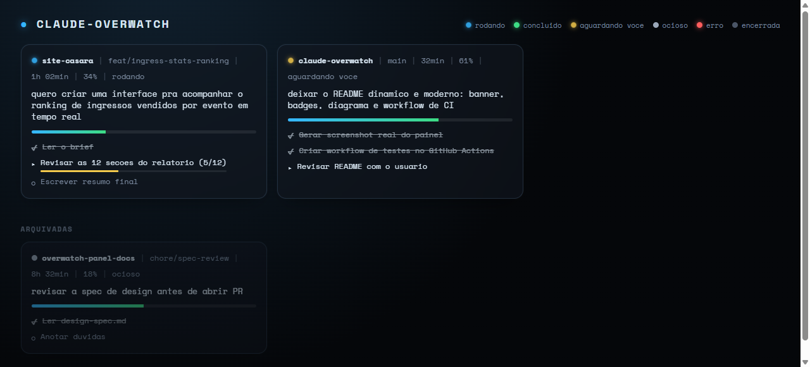
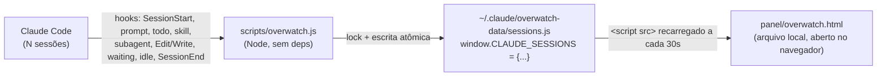

<p align="center">
  
</p>


[](https://github.com/LuizCasara/overwatch-panel/commits/main)
[](https://github.com/LuizCasara/overwatch-panel)


Painel local (HTML, sem servidor) que mostra **todas as sessões ativas do
Claude Code na sua máquina** em tempo real: projeto, branch, resumo do
pedido, tempo aberto, % de contexto usado, status (rodando / aguardando você
/ ocioso / erro) e a lista de tarefas de cada uma.

Zero custo de tokens para manter atualizado — tudo é feito por hooks
(scripts determinísticos que reagem a eventos do Claude Code), não pelo
próprio Claude escrevendo arquivos.



*(dados de exemplo — o painel real reflete suas sessões do Claude Code)*

Ver o design completo em [`docs/design-spec.md`](docs/design-spec.md).

## Como funciona



Hooks determinísticos, não o próprio Claude, escrevem o estado — por isso o
custo de tokens é zero e o painel nunca fica desatualizado por "esquecimento".

## Status

MVP implementado e testado (`scripts/overwatch.js`, `install.mjs`,
`panel/overwatch.html`) — ver `.specs/features/session-overwatch-panel/`
para a spec, o design e a lista completa de tasks. O `install.mjs` mescla
hooks no `~/.claude/settings.json` global, é idempotente e preserva os hooks
de terceiros; rode-o de novo sempre que a tabela de hooks mudar.

### Integração com o spine

Além das sessões, o painel entende o fluxo do spine (`CLAUDE.md` do spine):

| Hook | Evento interno | O que alimenta |
|---|---|---|
| `PostToolUse` `Edit\|Write` em `work/features/<slug>/…` | `spec-tasks` | feature (`slug`, spec, tickets feitos/total) e a lista de tickets (`issues/NN-*.md`: `Status:` + checkboxes) |
| `PostToolUse` `Skill` | `skill` | skills usadas, `kind` (feature / bugfix) e o fluxo grill → spec → tickets → implement → review → commit → retro |
| `PreToolUse` `Agent\|Task` + `SubagentStart` / `SubagentStop` | `agent-launch`, `subagent-start`, `subagent-stop` | subagentes rodando/concluídos, com descrição e resumo |
| `Stop` / `UserPromptSubmit` | `idle`, `prompt` | `context_pct` calculado do transcript (o statusline não roda na extensão do VS Code) |

O fluxo é da **feature**, não da sessão: skills de todas as sessões com o
mesmo `slug` contam, porque o spine manda dar `/clear` entre etapas. Os
artefatos (spec, `issues/`, tickets `done`) também valem como evidência.
A janela de contexto assume 200k; use `OVERWATCH_CONTEXT_WINDOW` para outro valor.

## Testes

```bash
npm test
```

Roda os testes de `scripts/overwatch.js` (handlers de hook, lock de arquivo,
dispatch da CLI), `install.mjs` (merge de hooks/statusLine, geração de
`panel-config.js`) e `panel/format.js` (formatação/cálculo usados pelo
painel), todos com `node:test` nativo, sem dependências externas.

## Instalação

```bash
git clone <url-deste-repo> claude-overwatch
cd claude-overwatch
node install.mjs
```

Abre `panel/overwatch.html` automaticamente na primeira sessão ativa depois
disso.

## Reinstalação (PC reformatado)

Clone este repositório de novo no mesmo caminho (ou em qualquer caminho —
`install.mjs` usa o caminho absoluto de onde foi rodado) e rode
`node install.mjs` de novo. É idempotente: funde as entradas de hook no
`~/.claude/settings.json` sem duplicar nem remover hooks que você já tinha.

Se preferir, cole isto para o Claude Code em vez de rodar o comando você
mesmo:

> Clone o repositório `<url-deste-repo>` em `c:\projects\claude-overwatch` e
> rode `node install.mjs`. Me mostra o resultado.
